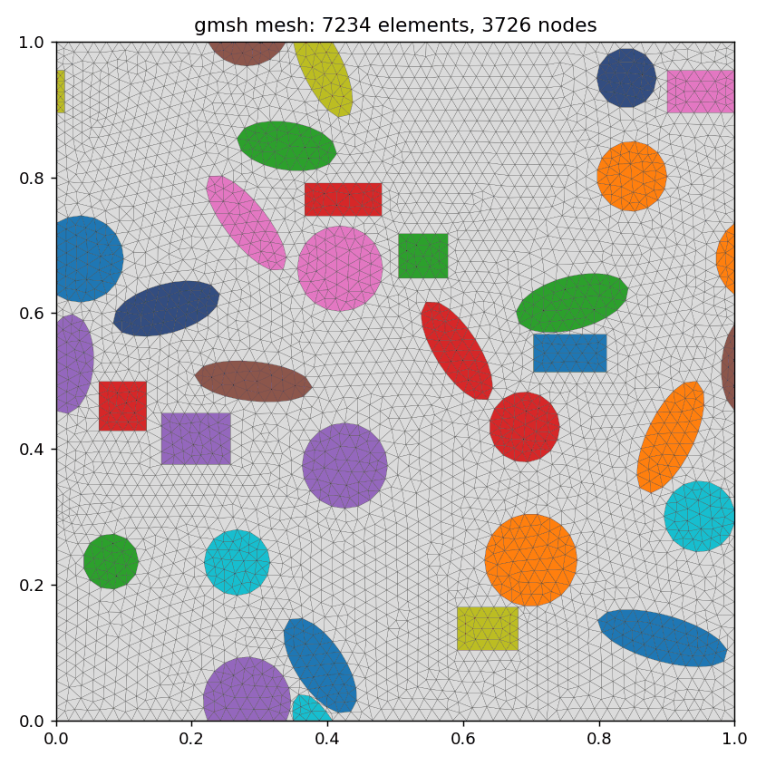
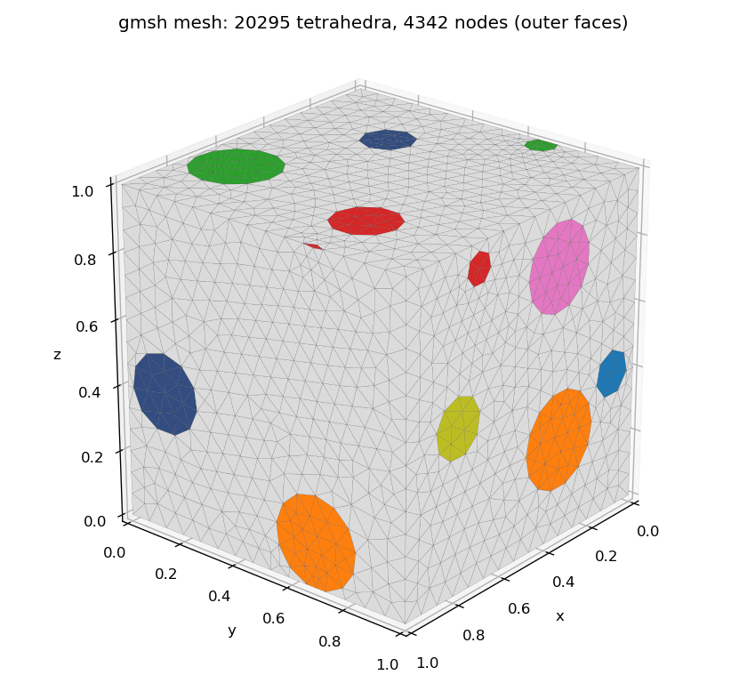
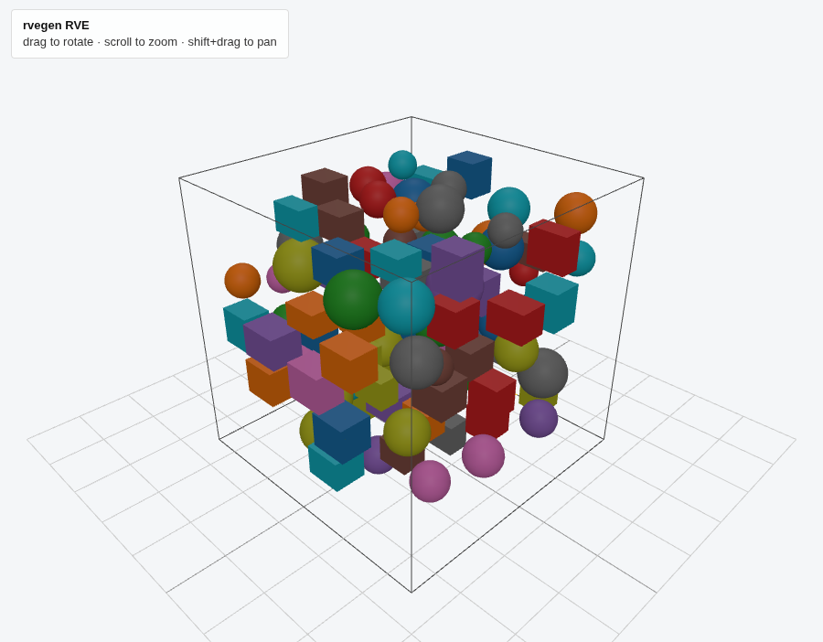

# rvegen

JSON-driven Representative Volume Element (RVE) generator: it places shapes in
a box and writes the geometry (gmsh `.geo`, voxel grids, VTK, SVG, three.js)
plus geometric statistics. It stops there: no homogenization, effective
properties or material models are computed or described.

The library produces synthetic microstructures — random packings of circles,
ellipses, spheres, rectangles, boxes, fibre tubes, mesh-defined inclusions and
other shapes — fully described by a JSON config
file. The output is either a gmsh `.geo` script (for FEM meshing) or a regular
voxel grid (for FFT solvers), plus VTK, SVG, three.js and statistics outputs
for inspection and analysis.

The architecture is layered, header-only, and designed for extension: every
generator strategy, distribution, shape input, termination predicate, and
post-process is a registered type selectable by name from JSON. Adding a new
type does not require modifying any existing code.

<p>



</p>

More pictures, one per config in `examples/`, are in the
[example gallery](docs/gallery/README.md). It is generated by
`scripts/make_gallery.py`; rerun it with `cmake --build build --target gallery`.

---

## Quick start

```bash
# 1. Dependencies: Boost headers, Eigen, nlohmann_json (e.g. Debian/Ubuntu:
#    libboost-dev libeigen3-dev nlohmann-json3-dev) and numsim-core >= 1.3,
#    installed to a prefix:
git clone --branch v1.3.0 https://github.com/NumSim-Stack/numsim-core.git
cmake -S numsim-core -B numsim-core/build -DCMAKE_CXX_COMPILER=g++-14 \
      -DNUMSIM_CORE_BUILD_TESTS=OFF -DNUMSIM_CORE_BUILD_EXAMPLES=OFF
cmake --install numsim-core/build --prefix "$HOME/numsim-deps"

# 2. rvegen:
cmake -S . -B build -DCMAKE_CXX_COMPILER=g++-14 -DCMAKE_PREFIX_PATH="$HOME/numsim-deps"
cmake --build build
cd build && ./rvegen ../examples/circles_in_unit_box.json
# -> rvegen: generated 10 shapes
# -> rvegen: post-process 'voxel' done   (writes circles_in_unit_box.vox)

ctest --output-on-failure
```

The CLI takes the config file and a few options (`rvegen` without arguments
lists them). Output files come from each `postprocess[].output_path` entry and
are written relative to the current directory. `rvegen --list-types` prints
every registered type.

The whole config is validated before the first shape is placed: every block is
built, phases are parsed, and each writer's output directory must exist and be
writable. A mistake in the last writer therefore costs no generation time and
leaves no half-written set of files. An unknown top-level key is an error, with
the key it most likely meant (`"post_process"` -> `"postprocess"`); keys
starting with `_`, such as `_comment`, are ignored. `--allow-unknown-keys`
turns that error into a warning.

```bash
./build/rvegen --check examples/circles_in_unit_box.json
# -> rvegen: config OK: examples/circles_in_unit_box.json   (nothing generated or written)
```

**Targets.** A placement generator also stops when it runs out of
`max_attempts`. Every run says what it reached; a missed target is a warning on
stderr, and an error with `--strict` (or `"strict": true` in the config): exit
status 1 and no output file.

```bash
./build/rvegen examples/polydisperse_circles.json
# -> rvegen: volume_fraction: reached 0.3515 of 0.35 after 177 attempts
./build/rvegen --strict tests/data/unreachable_spheres.json
# -> rvegen: error: target not reached - volume_fraction: reached 0.2687 of 0.6 after 200000 attempts (max_attempts)
```

A `{"type": "run_summary", "output_path": "run.json"}` entry under
`postprocess` writes the same report as JSON, together with the seed, the
rvegen version, the config, the shape count and the volume fraction, one file
per run for studies over many seeds.

**Files and output.** A relative input path in a config (`mesh_path`) is
resolved against the directory of the config file, so a config and its data
can be run from anywhere. A relative `output_path` is resolved against the
working directory, or against `--output-dir DIR` (an existing directory).
`--input-dir DIR` overrides the directory input paths are relative to.

```bash
./build/rvegen examples/mesh_inclusions_3d.json --output-dir results   # reads examples/data/octahedron.stl
./build/rvegen --quiet   examples/circles_in_unit_box.json   # prints nothing on success
./build/rvegen --verbose examples/voronoi_3d.json            # + defaults used per block, resolved paths, seed
```

`--quiet` silences the progress lines on stdout; warnings and errors still go
to stderr.

The compiler must provide C++23 `<print>` (GCC 14+, or Clang 17+ with a recent
libc++/libstdc++). With a system default of GCC 13 the configure step stops at
the `<print>` check, hence `-DCMAKE_CXX_COMPILER=g++-14` above.

rvegen depends on [numsim-core](https://github.com/NumSim-Stack/numsim-core)
1.3 or newer (older versions are not accepted).
CMake first looks for its installed package (`find_package(numsim-core 1.3 CONFIG)`;
set `CMAKE_PREFIX_PATH` to its install prefix) and falls back to a sibling
checkout at `../../numsim-core/include` relative to this repository. If both
exist the package wins; `-DCMAKE_DISABLE_FIND_PACKAGE_numsim-core=ON` forces
the sibling (useful when an old install shadows a newer checkout).

---

## JSON config schema

Top-level structure:

```json
{
  "domain_box":    [Lx, Ly] or [Lx, Ly, Lz],
  "seed":          <integer>,
  "distributions": { "<name>": { "type": "...", ...params }, ... },
  "shapes":        [ { "type": "...", ...params }, ... ],
  "generator":     { "type": "...", ...params },
  "termination":   { "type": "...", ...params },
  "postprocess":   [ { "type": "...", "output_path": "...", ...params }, ... ]
}
```

`domain_box` fixes the dimension of the RVE: `[Lx, Ly]` is a 2D rectangle,
`[Lx, Ly, Lz]` a 3D cuboid (`[Lx, Ly, 0]` is also read as 2D). The extents
must be finite, `Lx` and `Ly` positive. The shapes must have the same
dimension: a config with a `circle_input` in a 3D box, or a `sphere_input`
in a 2D one, is rejected when it is loaded, with the entry named. `seed` is optional;
defaults to 42. `distributions`, `shapes`, `generator` and `termination` select
registered types by name; `postprocess` is an array, and every entry owns its
output file via `output_path`, so one run can write several formats.

### Catalogue of built-in types

Every registered `"type"` per registry (generated by `rvegen --list-types`; a
CTest check fails if this list drifts from the registries):

<!-- BEGIN list-types -->
- **distributions (`distributions`)**: `constant`, `normal`, `oriented_uniform`, `uniform_real`, `von_mises`, `von_mises_a2`
- **direction distributions (`direction_distributions`)**: `bingham`, `bingham_a2`
- **shapes (`shapes`)**: `box_input`, `circle_input`, `ellipse_input`, `mesh_inclusion_input`, `polyline_tube_directional_input`, `polyline_tube_input`, `polyline_tube_oriented_input`, `rectangle_input`, `sphere_input`
- **generators (`generator`)**: `only_inside`, `periodic`, `random`, `tow_weave`, `voronoi_2d`, `voronoi_3d`, `weave`
- **terminations (`termination`)**: `number_of_inclusions`, `until_full`, `volume_fraction`
- **post-processes (`postprocess`)**: `gmsh_geo`, `run_summary`, `statistics`, `svg`, `svg_3d`, `three_js`, `voxel`, `vtk_legacy`
<!-- END list-types -->

Common parameters (each type's full schema, with ranges and descriptions, is
declared by its static `parameters()` method):

| Section         | `"type"` value             | Params                                   |
|-----------------|----------------------------|------------------------------------------|
| **distributions** | `uniform_real`           | `a` (min), `b` (max)                     |
|                 | `normal`                   | `mean`, `stddev`                         |
|                 | `constant`                 | `value`                                  |
|                 | `oriented_uniform`         | uniformly distributed orientation        |
| **shapes**      | `circle_input`             | `pos_x_dist`, `pos_y_dist`, `radius_dist` |
|                 | `ellipse_input`            | position, semi-axis and rotation dists   |
|                 | `rectangle_input`          | `pos_x_dist`, `pos_y_dist`, `width_dist`, `height_dist` |
|                 | `sphere_input`             | `pos_x_dist`, `pos_y_dist`, `pos_z_dist`, `radius_dist` |
|                 | `box_input`                | 3 position + 3 extent dist names         |
|                 | `polyline_tube_input`, `polyline_tube_directional_input` | swept-tube fibres |
|                 | `mesh_inclusion_input`     | `mesh_path` (STL/PLY): placed copies of a triangle mesh |
| **generator**   | `only_inside`              | `max_attempts`; optional `min_gap`, `min_gap_relative`, `wall_gap` |
|                 | `periodic`                 | `max_attempts`; optional `min_gap`, `min_gap_relative`, `wall_gap` |
|                 | `random`                   | `max_attempts`; optional `min_gap`, `min_gap_relative`, `wall_gap` |
| **termination** | `number_of_inclusions`     | `target` (count)                         |
|                 | `volume_fraction`          | `target_fraction` (0..1)                 |
|                 | `until_full`               | (no params; relies on generator's cap)   |
| **postprocess** | `gmsh_geo`                 | `output_path`, `periodic`, mesh size / order / algorithm / recombine knobs |
|                 | `voxel`                    | `output_path`, `nx`, `ny`, `nz` (phase-id grid) |
|                 | `vtk_legacy`               | `output_path`, `nx`, `ny`, `nz` (ParaView-readable) |
|                 | `svg`                      | `output_path`, `canvas_width` (2D picture) |
|                 | `svg_3d`                   | `output_path`, `canvas_width` (projected 3D picture) |
|                 | `three_js`                 | `output_path` (HTML viewer; loads three.js from unpkg.com, so the page needs network access) |
|                 | `statistics`               | `output_path` (CSV), `nx`, `ny`, `nbins`: two-point correlation S2(r) and radial distribution g(r) |
|                 | `run_summary`              | `output_path` (JSON): rvegen version, seed, the config, the generation report, shape count and volume fraction |

The cross-references in shape inputs (e.g. `"pos_x_dist": "uniform_x"`) refer
to keys in the `distributions` block. The orchestrator builds distributions
first, then resolves these names when constructing inputs.

Every shape input also takes `phase_name` and `metadata`. `metadata` is a JSON
object whose entries are copied onto each shape the input produces:
`"metadata": {"batch": "A7", "angle_deg": 42.5}`. (The same object as a
JSON-encoded string, the form older configs use, is still accepted.)

**Periodic copies.** A periodic generator (`periodic`, and `voronoi_2d` /
`voronoi_3d` with `"periodic": true`) returns each inclusion that crosses a
face together with its translated copies, so writers see the complete box. A
copy is linked to its primary: it carries the lattice shift from it and both
share an inclusion id. Inclusion counts, volume fractions, statistics, phase
assignment by index and shape-index voxel output all count such an inclusion
once, including one centred exactly on a face or a corner.

**Minimum gaps.** Rejecting overlaps alone lets two inclusions end up 1e-6
apart, which a mesher answers with sliver elements or no mesh at all. The
placement generators `only_inside`, `periodic` and `random` take three
optional keys, all 0 by default:

| Key | Meaning |
|-----|---------|
| `min_gap` | Smallest distance between two inclusions, in box units. For a mesh, about the largest element size. |
| `min_gap_relative` | The same as a fraction of the equivalent diameter (the circle or sphere of equal area or volume) of the smaller of the two inclusions. The larger of the two requirements applies. |
| `wall_gap` | Clearance to the boundary of the box: an inclusion stays at least this far from a face or, where the generator lets it cross (`periodic`, `random`), reaches at least this far through it; likewise at the corners (2D) and the edges and corners (3D). |

The distance is measured between the shapes themselves for every built-in
pair (circle, ellipse, rectangle, sphere, box, tube, mesh inclusion), periodic
copies and all lattice images included. The gaps are recorded in the
generation report (`run_summary`, Python `summary["report"]`) and in a comment
line of the `.geo` and voxel files. With all three at 0 a run is bit-identical
to one without the keys. A gap lowers the densest packing a generator can
reach, so a `volume_fraction` target may need more `max_attempts` or become
unreachable; the report says which. `examples/periodic_min_gap.json` is a
periodic pack with `min_gap` and `wall_gap` set to the mesh size.

### Worked examples

`examples/` holds one config per feature area (2D/3D, periodic, polydisperse,
fibres, weaves, polycrystals, mesh inclusions, every writer); see the
[example gallery](docs/gallery/README.md) for pictures of each. A few starting
points:

- `examples/circles_in_unit_box.json`: 2D, 10 circles, voxel output.
- `examples/spheres_in_cube.json`: 3D, ~5% volume fraction, voxel output.
- `examples/periodic_circles.json`: 2D periodic, 20% volume fraction, VTK and
  gmsh output.
- `examples/fe_rve_workflow.json`: periodic gmsh geometry with element
  options and one physical group per phase.
- `examples/periodic_min_gap.json`: a minimum gap between inclusions and to
  the boundary.
- `examples/aligned_ellipses_a2.json`: orientations from a second-order
  orientation tensor.
- `examples/twill_weave.json`, `examples/satin_weave.json`: weave patterns,
  warp and weft as separate phases.
- `examples/voronoi_2d_gmsh.json`: polycrystal as a conforming gmsh geometry,
  one physical group per grain.
- `examples/voronoi_3d_grain_sizes.json`: periodic polycrystal with a
  prescribed grain-size distribution.
- `examples/mesh_inclusions_rotated.json`: copies of an STL mesh with random
  orientation and size.
- `examples/circles_statistics.json`: S2(r) and g(r) of a dense pack.

Run any of them with `./build/rvegen <path-to.json>` from any directory; the
files appear in the current directory (or in `--output-dir`). Assets a config
refers to (`mesh_inclusions_3d.json` reads `data/octahedron.stl`) are found
next to the config file.

---

## Adding a new type

The library is open for extension; [docs/extending.md](docs/extending.md) walks
through adding a shape, a generator and a post-process. To add (say) a new shape input type
`triangle_input`:

1. **Library code** — implement the shape if it doesn't exist
   (`include/rvegen/shapes/triangle.h`) by deriving from
   `numsim_core::static_indexing<triangle<T>, shape_base<T>>` and implementing
   the `shape_base<T>` virtuals, `is_inside(point)` included. Precise collision
   pairs are optional (`registry/register_collisions.h`); unregistered pairs
   use the bounding-box overlap test.

2. **Input** — `include/rvegen/inputs/triangle_input.h` with:
   - direct C++ ctor
   - schema-driven ctor `(parameter_handler_t const&, distribution_map_t<T> const&)`
   - static `parameters()` method declaring the JSON schema
   - `new_shape()` override

3. **Registration** — one line in
   `include/rvegen/registry/register_inputs.h`:
   ```cpp
   inline void register_triangle_input() {
     input_registry_t<T>::instance()
         .template register_type<triangle_input<T>>("triangle_input");
   }
   ```
   plus a call in `register_all_inputs()`.

JSON config can immediately use `"type": "triangle_input"`. Zero edits to the
CLI, the orchestrator, the existing generators, or any other shape.

The same recipe applies to new distributions, terminations, generators, and
post-processes — each lives in its own subdirectory with its own
`register_*.h`.

---

## Architecture

```
JSON config file
    │
    ▼  parse + validate
nlohmann::json
    │
    ▼  parameter_visitor_nlohmann + schema.accept(visitor, handler)
parameter_handler_t       (typed values, extracted from JSON)
    │
    ▼  registry.create(type_name, handler[, deps...])
unique_ptr<Base>          (concrete type chosen by JSON name)
    │
    ▼  pipeline orchestration
generator->compute(inputs, *termination, domain_box)
    │
    ▼
vector<unique_ptr<shape_base<T>>>
    │
    ▼  post_process->run(shapes, domain_box)   (one per "postprocess" entry)
.geo / .vox / .vtk / .svg / .html / .csv
```

Six registries handle the heterogeneous-by-name dispatch, one per concept:

| Registry                  | Base                  | Construction args                   |
|---------------------------|-----------------------|-------------------------------------|
| `distribution_registry_t` | `distribution_base`   | `(handler, Engine&)`                |
| `input_registry_t`        | `shape_input_base`    | `(handler, distribution_map<T>)`    |
| `generator_registry_t`    | `rve_generator_base`  | `(handler)`                         |
| `termination_registry_t`  | `termination_base`    | `(handler, std::array<T,3> box)`    |
| `post_process_registry_t` | `post_process_base`   | `(handler)`                         |
| `direction_distribution_registry_t` | `direction_distribution_base` | `(handler, Engine&)`   |

Each is a `numsim_core::object_registry` template instantiation. Registered
types provide a static `parameters()` schema and a ctor matching the
registry's `CtorArgs`. The schema lets the JSON visitor validate input before
construction.

The library is header-only (`rvegen_lib` is an `INTERFACE` CMake target).
Consumers `#include "rvegen/rvegen.h"` and link `rvegen_lib`.

---

## Threading

The library has no global mutable state on the hot path. Each thread builds
its own `std::mt19937` engine, its own distributions referencing that engine,
and its own pipeline; threads never share these.

| Component               | Thread safety                                           |
|-------------------------|---------------------------------------------------------|
| `std::mt19937` engine   | Per-thread (do not share — `mt19937` is not threadsafe) |
| Distribution wrappers   | Per-thread (each owns one engine reference)             |
| Registry singletons     | Read-only after `register_all_*()`; safe to query       |
| Generator instance      | Per-thread (cheap to construct; no shared state)        |
| Post-processes          | Per-thread for `run()`; the file stream is the user's   |

`tests/concurrency_smoke.cpp` verifies:
- Same seed across threads → bit-identical shape sequences (determinism).
- Different seeds → diverging shape sequences (engine isolation).
- 8-thread heavy load → all pipelines run to completion.

For ensemble Monte Carlo or parameter sweeps, the simplest pattern is to run
the CLI in parallel with different seeds — the pipeline is process-level
embarrassingly parallel.

---

## Reproducibility

A config with a fixed `seed` gives the same RVE again. How far "the same"
reaches depends on what is compared:

| What | Guarantee |
|------|-----------|
| Same executable, same machine | Identical output files, on every run and from every thread. |
| The drawn values: positions, sizes, angles, directions (von Mises, Bingham), uniform rotations, lognormal grain sizes, Voronoi seeds | Bit-identical on every platform with IEEE-754 doubles: any standard library (libstdc++, libc++, MSVC), any math library, with or without fused multiply-add. |
| Which candidates are accepted (the shape list of `only_inside`, `random`, `periodic`) | The candidates are the drawn values above; whether one is accepted is decided by an overlap test in ordinary floating point. The list is therefore identical across platforms unless a test lands within rounding of a tie, which fused multiply-add or another math library (ellipse axes use the platform `sin`/`cos`) can then decide the other way. The pinned test configs give the same list on every CI leg. |
| Geometry computed from the drawn values (tube centre lines, bounding boxes of rotated shapes, Voronoi cells, the grain-size fit, mesh inclusions) | Bit-identical across compilers and standard libraries. A build that fuses multiply-add (`-march` with FMA under GCC's default `-ffp-contract=fast`, AArch64) or a different math library can change the last bits; next to a tie that can flip one accept/reject decision, and the shape list differs from there on. |
| A2-fitted orientation distributions (`bingham_a2`, `von_mises_a2`) | The concentration is fitted with the platform math library, so their samples are reproducible per platform only. |

Not covered: `-ffast-math` / `/fp:fast`, x87 arithmetic, and different rvegen
versions (a change that alters seeded results says so in its description).

How it is done: the engines of `<random>` are fully specified, the
distributions are not. rvegen therefore draws through its own transforms
(`distributions/portable_random.h`) and its own `exp`, `log`, `sin`, `cos`,
`acos` and cube root (`distributions/portable_math.h`), which use only
operations that IEEE-754 defines exactly. `tests/golden_portable_test.cpp`,
`tests/golden_random_test.cpp` and `tests/golden_generators_test.cpp` pin the
results; CI runs them against libstdc++, libc++ and the MSVC standard
library. `tests/no_std_distribution_check.py` keeps `std::*_distribution`
and `std::shuffle` out of the library.

`seed` is an integer from 0 to 2³² − 1; a larger value is rejected, not
truncated.

---

## Project layout

```
include/rvegen/
  rvegen.h                  umbrella include
  types.h                   parameter_handler_t, parameter_controller_t aliases

  shapes/                   shape_base + circle, ellipse, sphere, rectangle, box,
                            polyline_tube, convex_polygon, voronoi_cell,
                            mesh_inclusion (bounding_box_base hierarchy alongside)
  intersection/             collision_details overload set, dispatcher, AABB helpers
  distributions/            distribution_base + uniform_real, normal, constant,
                            von_mises; direction distributions (bingham), both
                            also from a 2nd-order orientation tensor (*_a2)
  inputs/                   shape_input_base + one input per shape type
  termination/              termination_base + number_of_inclusions,
                            volume_fraction, until_full
  generators/               rve_generator_base + only_inside, periodic, random;
                            deterministic voronoi_2d / voronoi_3d, weave,
                            tow_weave
  postprocess/              post_process_base + gmsh_geo, voxel, vtk_legacy, svg,
                            svg_3d, three_js, statistics; voxel_grid helper
  statistics/               S2(r) / g(r) microstructure statistics
  visualization/            mesh_dispatcher + per-shape triangle meshes
  io/                       STL / PLY mesh readers
  phase/                    phase tags for voxel output
  metadata/                 library info
  schema/                   schema_to_json: registry schemas as JSON
  registry/                 register_*.h per category + build_from_json helper
  json/                     parameter_visitor_nlohmann

apps/rvegen_cli.cpp         the JSON-driven executable
examples/                   bundled example configs (+ data/ assets)
scripts/make_gallery.py     renders every example into docs/gallery/
scripts/run_benchmarks.py   times the cases of bench/cases.py, checks scaling
bench/                      benchmark cases; Google Benchmark micro-benchmarks
python/                     optional pybind11 bindings (RVEGEN_BUILD_PYTHON=ON)
docs/                       API-reference config, contributor docs, gallery,
                            performance.md
tests/                      smoke tests, CLI example checks; all under ctest
```

---

## Build options

| Option                       | Default | Effect                                    |
|------------------------------|---------|-------------------------------------------|
| `BUILD_TESTING`              | `ON`    | Register the CTest suite                  |
| `RVEGEN_BUILD_DOCS`          | `OFF`   | Doxygen API reference (`docs` target)     |
| `RVEGEN_BUILD_PYTHON`        | `OFF`   | pybind11 bindings under `python/`         |

The default build needs Boost headers, Eigen, nlohmann_json and numsim-core
(>= 1.3), all installed. CMake does fall back to downloading Eigen or
nlohmann_json when they are missing, but the install/export rules then fail at
generate time, so install them (the quick start lists the packages).

### Tests

`ctest --test-dir build` runs the unit and smoke tests plus one
`cli_check_<name>` test per config in `examples/` (select them with
`ctest -R cli_check`). When Python 3 is found,
those run `tests/cli_example_check.py`, which executes the CLI and inspects
every written file: voxel and VTK headers against their value counts, SVG as
XML, statistics CSV for non-trivial S2/g, and `.geo` files through gmsh when it
is installed. A further test runs `scripts/make_gallery.py` when numpy and
matplotlib are available, and one checks that the type list above matches the
registries. CI additionally builds Debug with AddressSanitizer and UBSan, and
builds with Clang.

### Performance

[`docs/performance.md`](docs/performance.md) has reference timings (10^5
circles at 40 % in 0.6 s, 10^5 spheres at 30 % in 4.4 s, a periodic 2D
Voronoi tessellation of 10^5 seeds in 2.8 s, on a laptop) and how they scale.
`scripts/run_benchmarks.py --rvegen build/rvegen` measures them again in about
a minute, `--compare` sets two measurements side by side, and CI checks on
every pull request that no benchmark family has turned quadratic.

---

## License

rvegen is distributed under the BSD 3-Clause License, see [`LICENSE`](LICENSE).
The licences of the bundled and build-time components (GTE, nlohmann/json,
pybind11, Eigen, Boost) are listed in
[`THIRD_PARTY_NOTICES.md`](THIRD_PARTY_NOTICES.md).

---

## Status / roadmap

The current state covers the JSON-driven core, three generator strategies, the
gmsh + voxel + VTK output paths, and a thread-safe distribution layer. See
`REFACTORING_PLAN.md` for the phase-by-phase migration history and remaining
backlog (rotation support, GTE-backed precise collision dispatch, more shape
types).
