# rvegen example gallery

<!-- Generated by scripts/make_gallery.py; do not edit by hand. -->

Every picture below is rendered from a config in `examples/`. Regenerate with
`scripts/make_gallery.py` or `cmake --build build --target gallery`.

Each config runs from any directory: rvegen resolves relative input paths
(`mesh_path`) against the config's directory.

The `gmsh_geo` pictures were meshed with gmsh 4.12.1; other gmsh
versions mesh differently, so the element counts in their titles change.

## aligned_ellipses_a2

[`aligned_ellipses_a2.json`](../../examples/aligned_ellipses_a2.json) · 2D 1×1 · ellipse_input · generator `periodic` · 92 shapes

> Ellipses whose long axes follow a prescribed second-order orientation tensor: von_mises_a2 takes the tensor components (here a11 = 0.85, strongly aligned with x) and fits the concentration of the angle distribution to them.

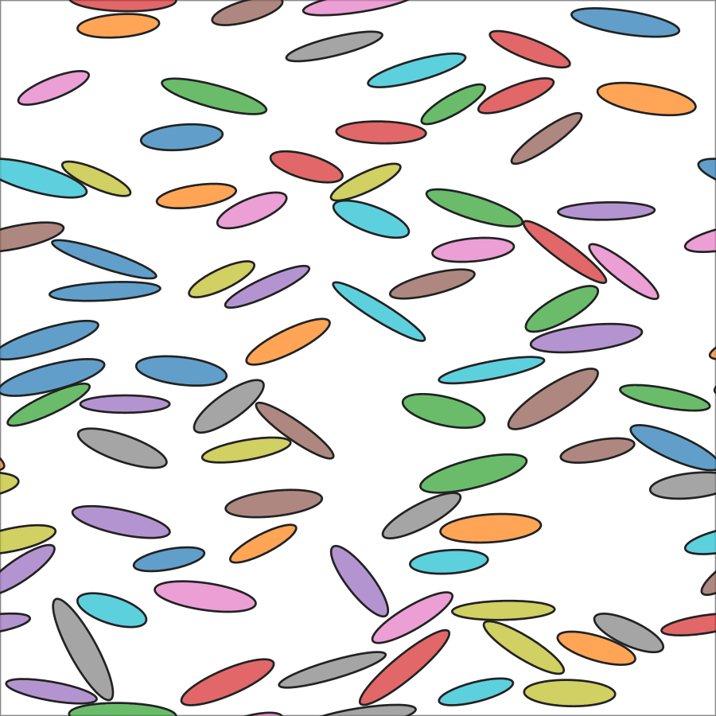

## bingham_fibres

[`bingham_fibres.json`](../../examples/bingham_fibres.json) · 3D 1×1×1 · polyline_tube_oriented_input · generator `random` · 15 shapes

> Fibres whose axes follow a Bingham distribution (prolate, mean axis +x) via polyline_tube_oriented_input; direction distributions live in their own section. The 32^3 voxel grid is a preview: the fibres are 1.3 voxels thick, so the resolution check is switched off ("min_voxels_per_feature": 0); without the key the run warns and names the grid a solver needs (200^3).

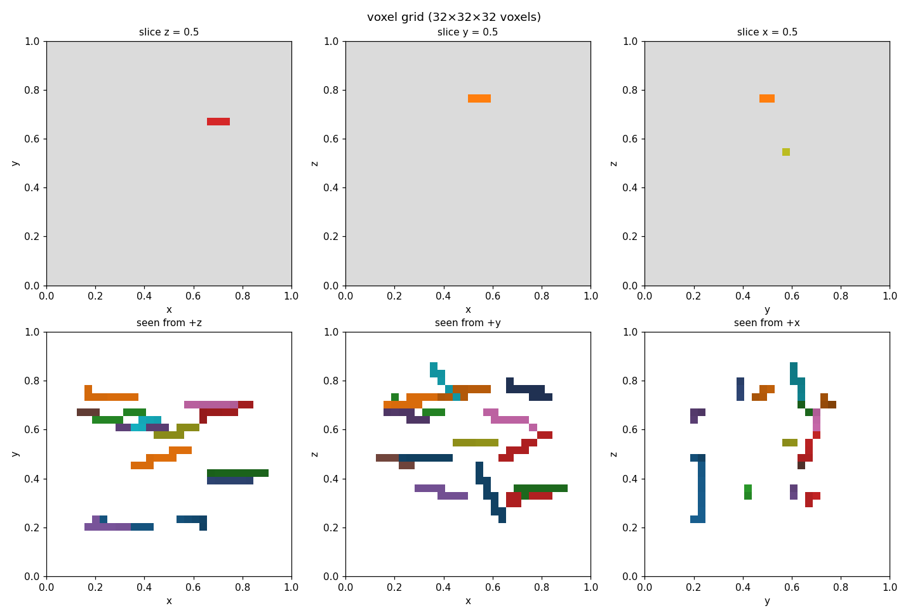

## circles_in_unit_box

[`circles_in_unit_box.json`](../../examples/circles_in_unit_box.json) · 2D 1×1 · circle_input · generator `only_inside` · 10 shapes

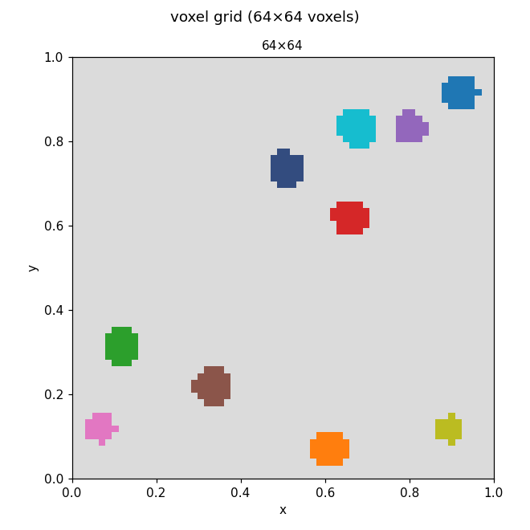

## circles_statistics

[`circles_statistics.json`](../../examples/circles_statistics.json) · 2D 1×1 · circle_input · generator `periodic` · 157 shapes

> Dense periodic monodisperse circle pack (40 % area fraction) with the statistics post-process: two-point correlation S2(r), which starts at the area fraction and decays to its square, and the radial distribution g(r) of the centres, which shows the hard-core exclusion and the first-neighbour peak.

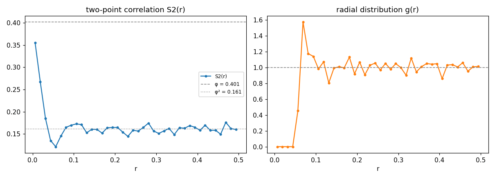

## circles_with_voxelize

[`circles_with_voxelize.json`](../../examples/circles_with_voxelize.json) · 2D 1×1 · circle_input · generator `only_inside` · 10 shapes

## dense_circles_svg

[`dense_circles_svg.json`](../../examples/dense_circles_svg.json) · 2D 1×1 · circle_input · generator `only_inside` · 51 shapes

> Dense 2D RVE — 30% volume fraction of mixed-radius circles in a unit box. only_inside generator + precise dispatch packs more circles than AABB-only would. SVG output for visualization.

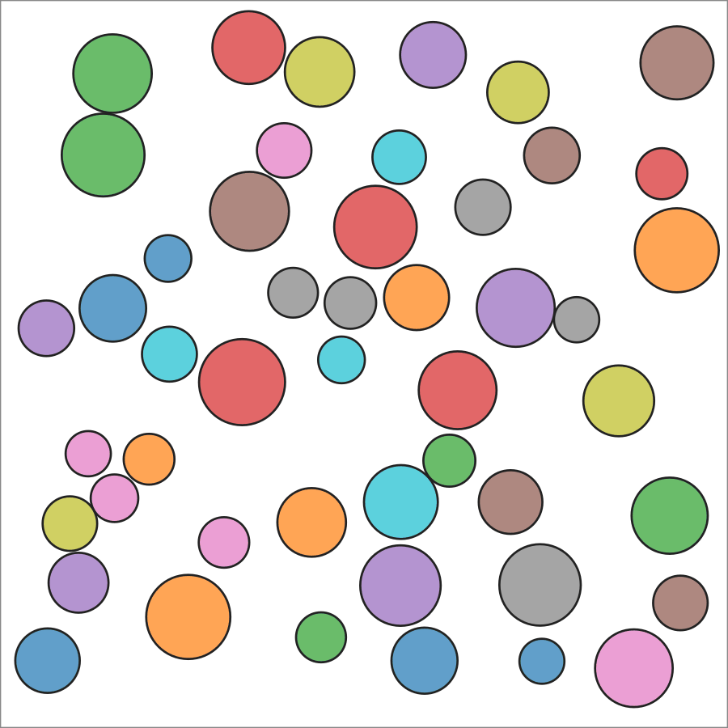

## dense_spheres_3d

[`dense_spheres_3d.json`](../../examples/dense_spheres_3d.json) · 3D 1×1×1 · sphere_input · generator `only_inside` · 49 shapes

> Dense 3D RVE — spheres in a unit cube, ~10% volume fraction. Three.js HTML output: drag to rotate, scroll to zoom in your browser.

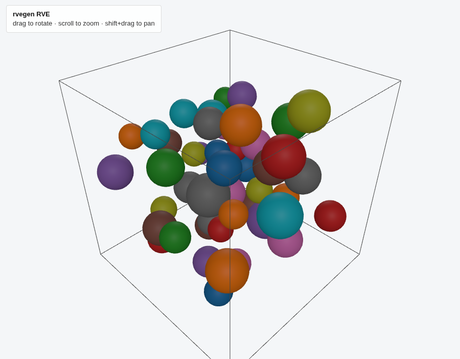

## dense_spheres_svg3d

[`dense_spheres_svg3d.json`](../../examples/dense_spheres_svg3d.json) · 3D 1×1×1 · sphere_input · generator `only_inside` · 49 shapes

> Dense 3D sphere RVE rendered as static SVG (orthographic axonometric).

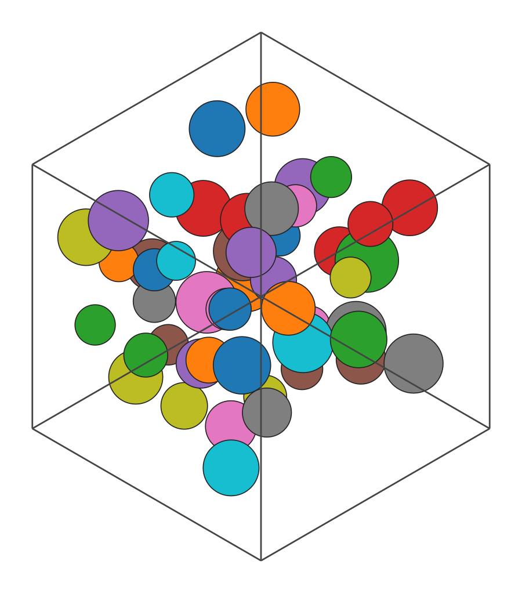

## fe_rve_workflow

[`fe_rve_workflow.json`](../../examples/fe_rve_workflow.json) · 2D 1×1 · circle_input · generator `periodic` · 34 shapes

> Periodic 2D circle pack at 20 % as a gmsh geometry with the options a finite-element mesh usually needs: periodic curve constraints, element sizes, quadratic elements, Frontal-Delaunay meshing (algorithm 6; algorithm 8 crashes gmsh 4.12 when periodic constraints are present) and recombination into quads. The phases declared here become physical groups in the .geo: Physical Surface("fibre") for the circles and Physical Surface("matrix") for the rest.

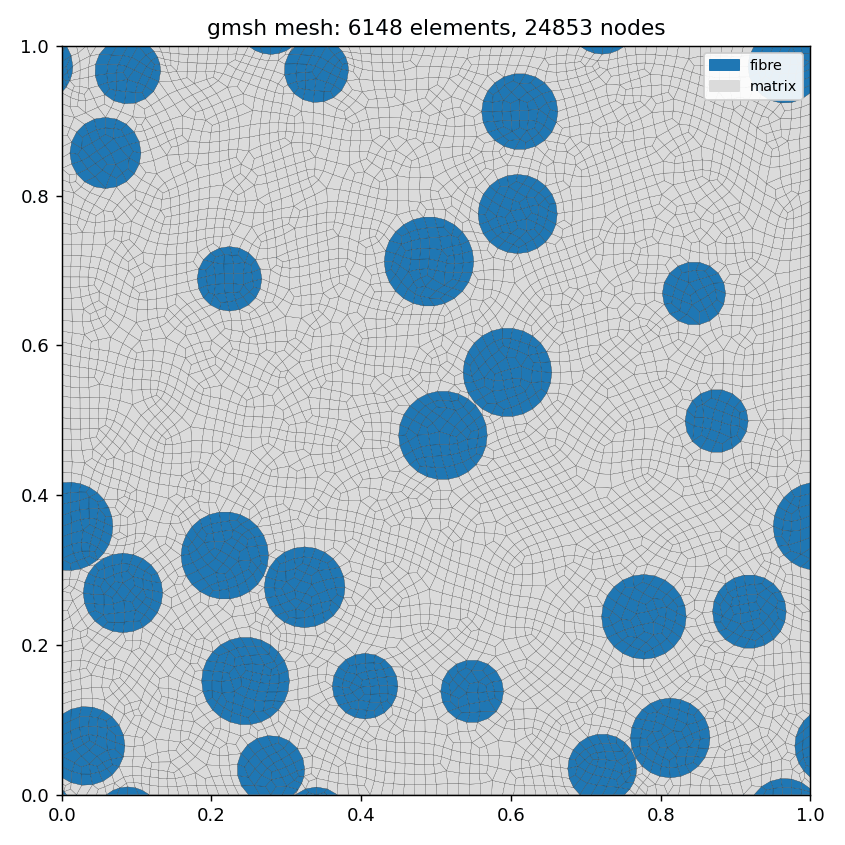

## fibres_3d

[`fibres_3d.json`](../../examples/fibres_3d.json) · 3D 1×1×1 · polyline_tube_input · generator `only_inside` · 10 shapes

> Straight cylindrical fibres (polyline tubes) running roughly along z through a unit cube, voxelised to 64^3 and shown as three orthogonal mid-plane slices. Tubes have no precise collision pair yet, so placement uses conservative bounding-box checks.

## mesh_inclusions_3d

[`mesh_inclusions_3d.json`](../../examples/mesh_inclusions_3d.json) · 3D 1×1×1 · mesh_inclusion_input · generator `only_inside` · 40 shapes

> Arbitrary inclusion geometry from a triangle mesh: copies of an octahedron read from data/octahedron.stl, placed without overlap and voxelised to 64^3. The mesh_path is relative to this config file, so the example runs from any directory.

## mesh_inclusions_rotated

[`mesh_inclusions_rotated.json`](../../examples/mesh_inclusions_rotated.json) · 3D 1×1×1 · mesh_inclusion_input · generator `only_inside` · 40 shapes

> Copies of one triangle mesh (data/octahedron.stl) with a random orientation and a random size each: orientation 'uniform' draws isotropic rotations, scale_dist the scale factor. All copies share the triangles of the file.

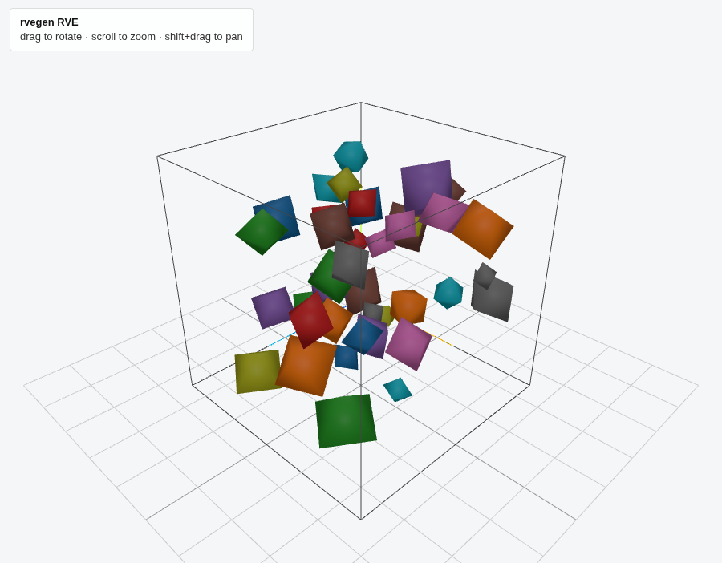

## mixed_2d_periodic_gmsh

[`mixed_2d_periodic_gmsh.json`](../../examples/mixed_2d_periodic_gmsh.json) · 2D 1×1 · circle_input, ellipse_input, rectangle_input · generator `periodic` · 39 shapes

> Periodic 2D RVE mixing circles, ellipses and rectangles, written as a gmsh .geo with periodic boundary constraints. Inclusions that cross the boundary are clipped and their wrap copies appear on the opposite face.

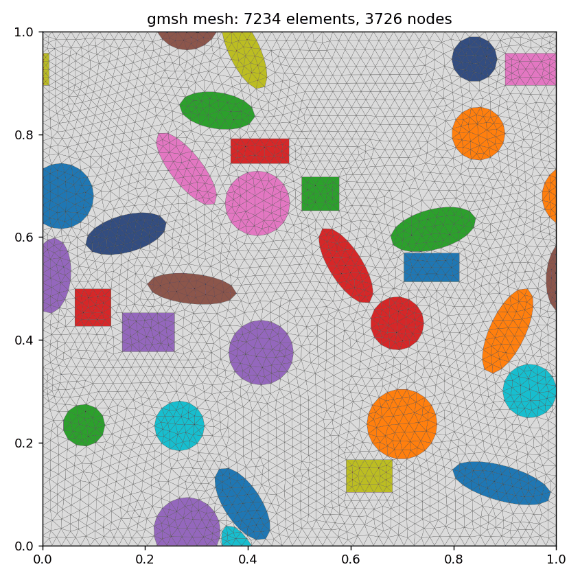

## mixed_2d_svg

[`mixed_2d_svg.json`](../../examples/mixed_2d_svg.json) · 2D 1×1 · circle_input, ellipse_input, rectangle_input · generator `only_inside` · 45 shapes

> Mixed circles + rectangles + ellipses, 25% volume fraction, only_inside generator. Shows the heterogeneous-shape capability with precise pairwise collision dispatch.

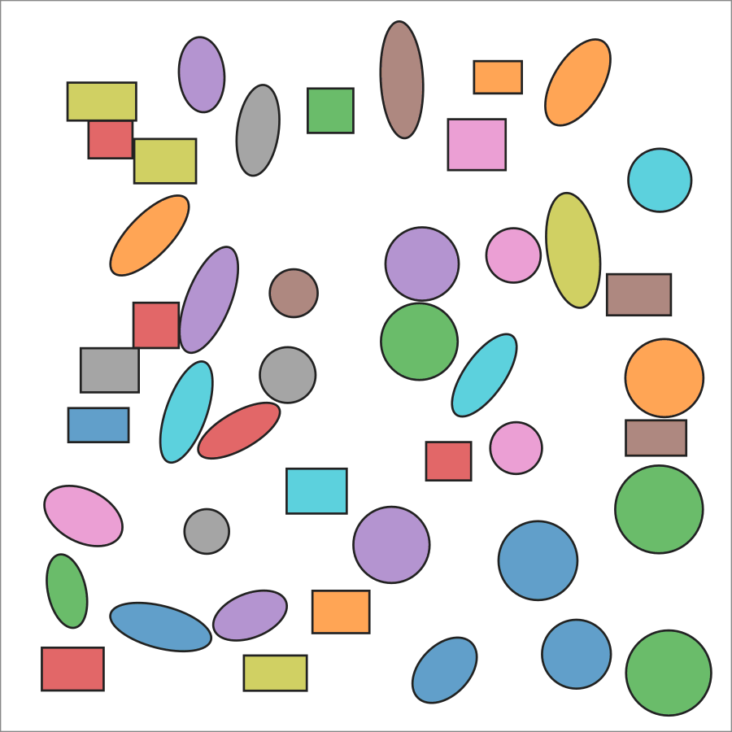

## mixed_3d

[`mixed_3d.json`](../../examples/mixed_3d.json) · 3D 1×1×1 · box_input, sphere_input · generator `only_inside` · 110 shapes

> Mixed 3D RVE — spheres + boxes in a unit cube, 15% volume fraction.

## mixed_3d_svg

[`mixed_3d_svg.json`](../../examples/mixed_3d_svg.json) · 3D 1×1×1 · box_input, sphere_input · generator `only_inside` · 110 shapes

> Mixed 3D RVE — spheres + boxes — rendered as static SVG.

## partial_volume_voxels

[`partial_volume_voxels.json`](../../examples/partial_volume_voxels.json) · 2D 1×1 · circle_input · generator `periodic` · 33 shapes

> Partial-volume voxels for FFT solvers. Every voxel is sampled at 4 x 4 points instead of its centre ("subsamples": 4): the voxel file lists, after the grid of dominant ids, the voxels an interface runs through with the share of each id, and the VTK file carries the shares as the cell array volume_fraction. The run prints the volume fraction of the grid next to the one of the shapes; at 96 x 96 the smallest circle is 9.6 voxels across, above the 8 the writers ask for ("min_voxels_per_feature").

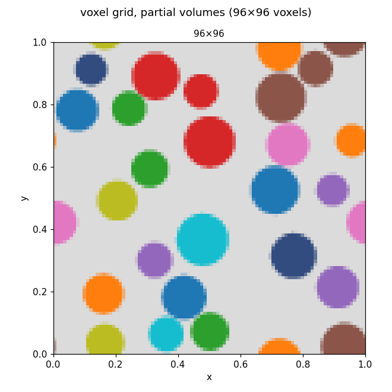

## periodic_circles

[`periodic_circles.json`](../../examples/periodic_circles.json) · 2D 1×1 · circle_input · generator `periodic` · 17 shapes

> Periodic 2D RVE: circles wrapping across box faces, written as a ParaView-readable VTK file. Canonical periodic config, e.g. for FFT voxel grids.

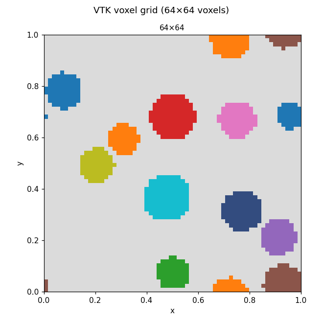
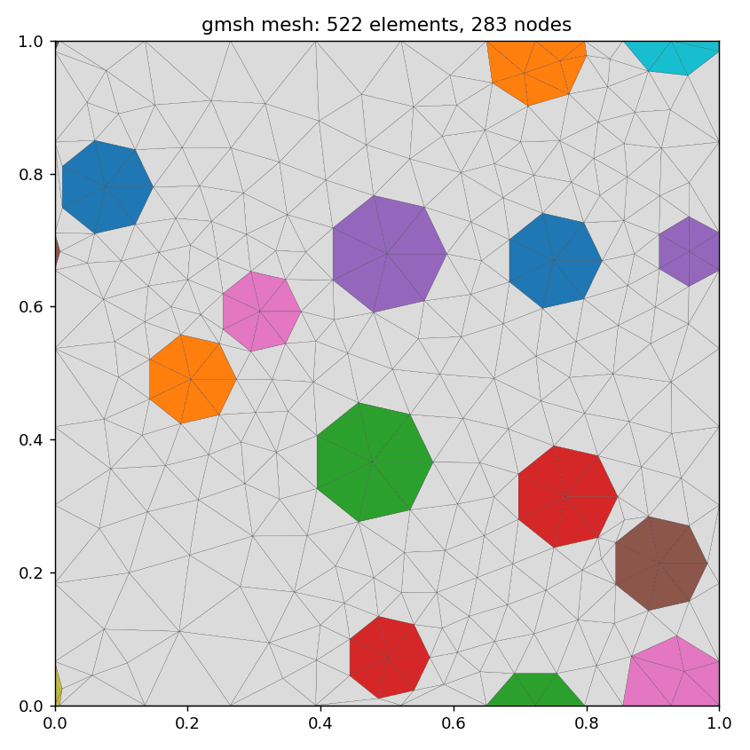

## periodic_ellipses_svg

[`periodic_ellipses_svg.json`](../../examples/periodic_ellipses_svg.json) · 2D 1×1 · ellipse_input · generator `periodic` · 28 shapes

> Periodic 2D RVE with rotated ellipses. Note how shapes near the boundary get visible wrap-copies on the opposite face — this is the periodic unit cell.

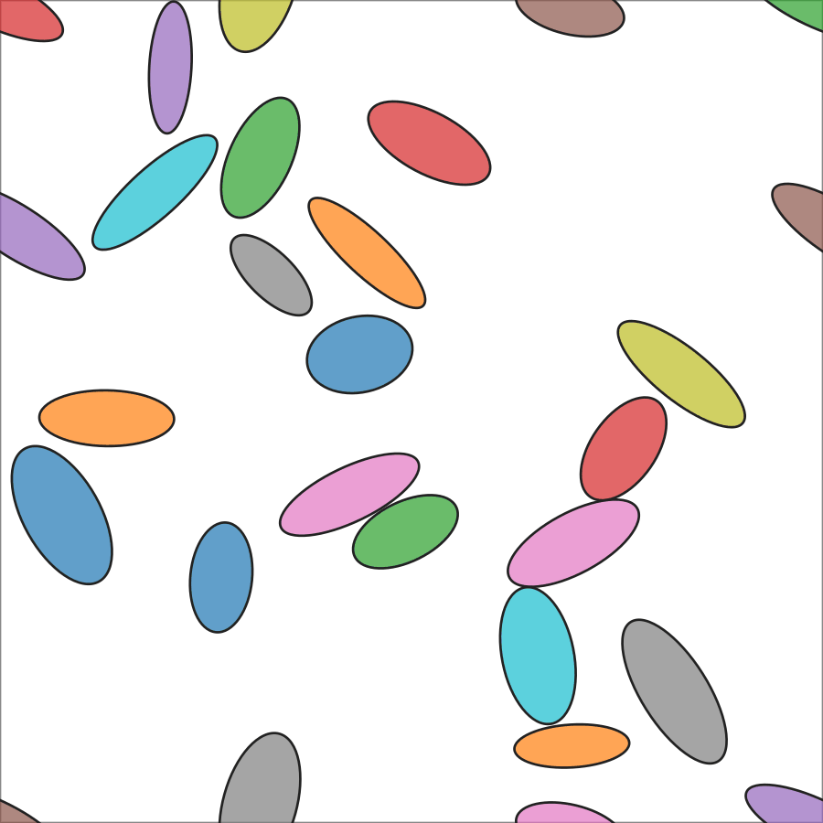

## periodic_min_gap

[`periodic_min_gap.json`](../../examples/periodic_min_gap.json) · 2D 1×1 · circle_input · generator `periodic` · 34 shapes

> Periodic 2D pack that a mesher can take as it is: min_gap keeps every two circles at least one element size apart, wall_gap does the same at the box faces and corners (a circle stays that far away or reaches that far through). Without the two keys the same pack contains circles 1e-3 apart and caps a few 1e-3 thick, which gmsh resolves with slivers.

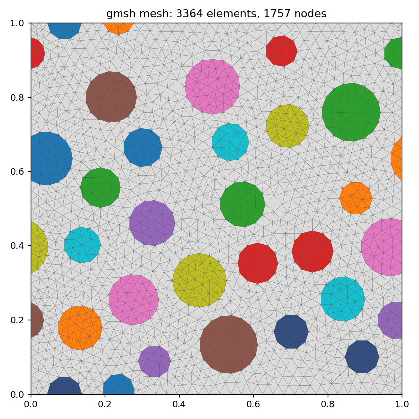

## periodic_spheres_gmsh_3d

[`periodic_spheres_gmsh_3d.json`](../../examples/periodic_spheres_gmsh_3d.json) · 3D 1×1×1 · sphere_input · generator `periodic` · 36 shapes

> Periodic 3D sphere pack written as a gmsh .geo with periodic surface constraints, ready for a tetrahedral FE mesh. Spheres that cross a face are clipped and their wrap copies appear on the opposite face.

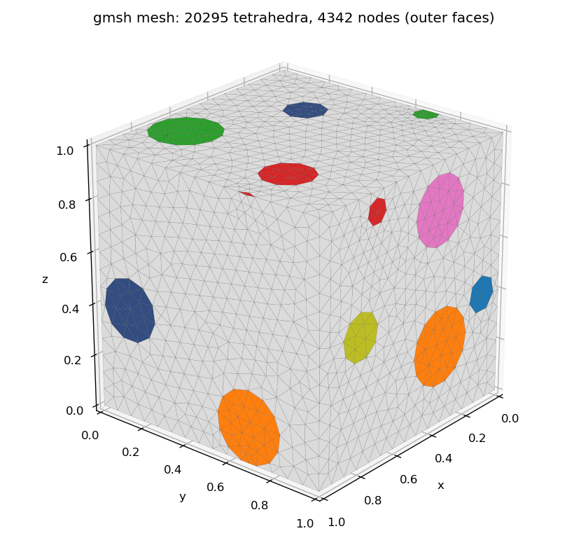

## phases_voxel

[`phases_voxel.json`](../../examples/phases_voxel.json) · 2D 1×1 · circle_input, rectangle_input · generator `only_inside` · 12 shapes

> Phases + phase_assignment. Circles become 'fibre' and rectangles 'filler' (by_shape_type); cells no shape covers belong to the declared matrix phase and carry its id (id 0 would mean an untagged shape). The voxel grid and the VTK file carry the phase ids, and each writes a <output>.phases.json name table next to it; materials are assigned downstream by phase name or id.

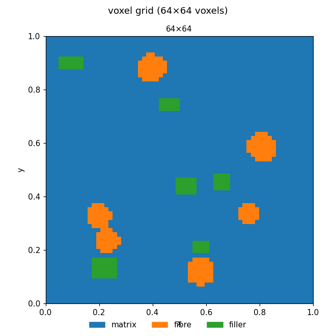
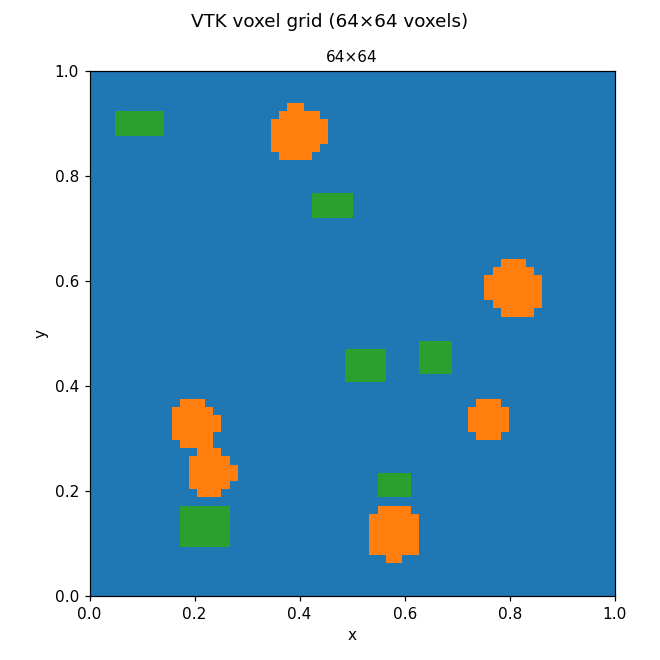

## plain_weave

[`plain_weave.json`](../../examples/plain_weave.json) · 3D 1×1×0.25 ·  · generator `weave` · 8 shapes

> Plain weave: 4 warp x 4 weft undulating yarns (deterministic; no shapes/termination needed).

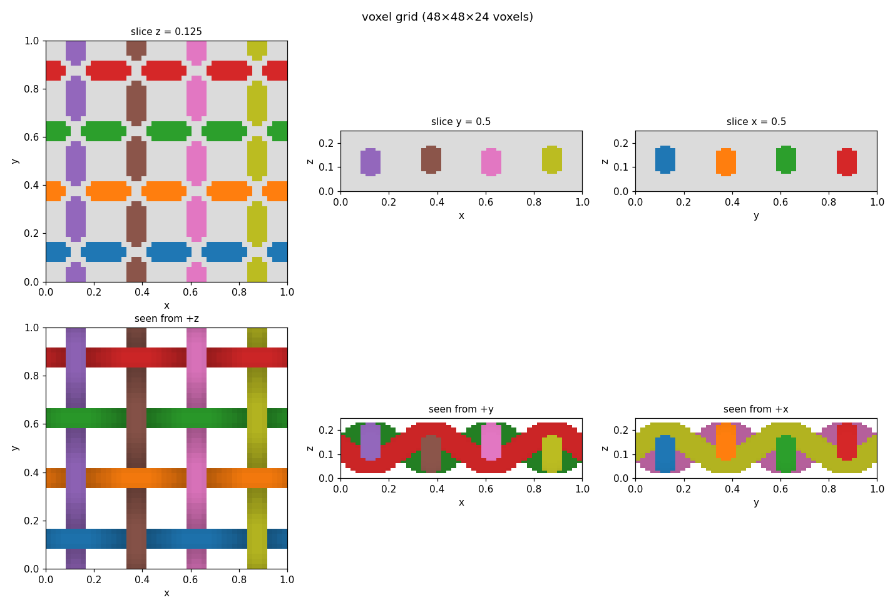

## polydisperse_circles

[`polydisperse_circles.json`](../../examples/polydisperse_circles.json) · 2D 1×1 · circle_input · generator `only_inside` · 47 shapes

> Polydisperse circles with normally distributed radii (mean 0.05, standard deviation 0.01) packed inside the box, voxelised to a 128x128 grid for FFT solvers.

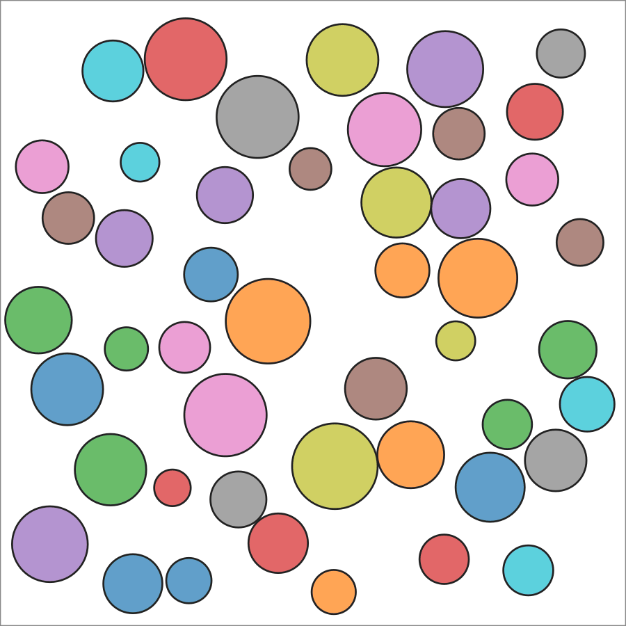

## satin_weave

[`satin_weave.json`](../../examples/satin_weave.json) · 3D 1×1×0.2 ·  · generator `weave` · 20 shapes

> Satin 5 weave: each yarn floats over four crossing yarns and dips under the fifth, with the dips spread so that no two touch. Long floats, few interlacings. Warp and weft carry their own phase.

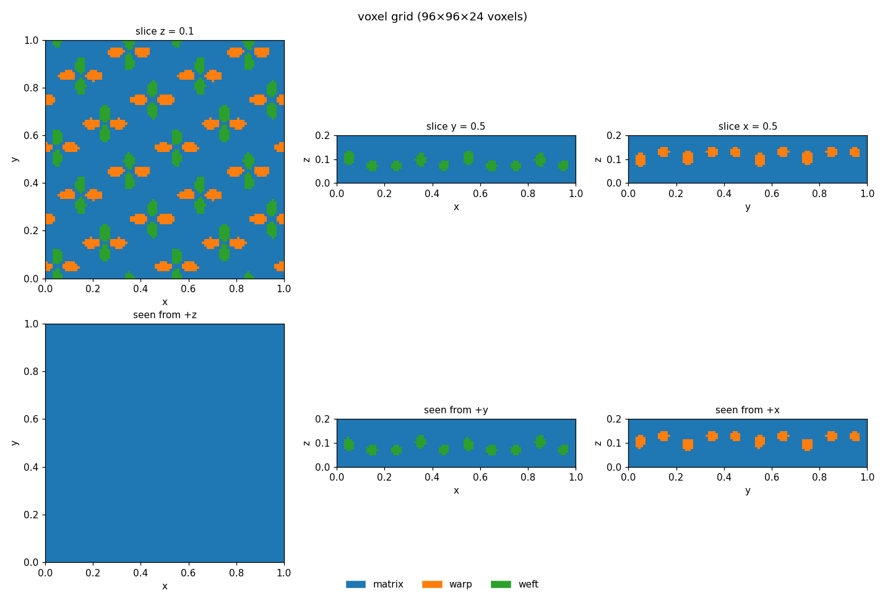
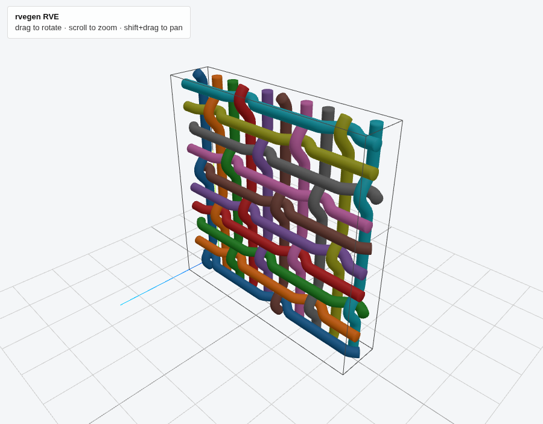

## spheres_in_cube

[`spheres_in_cube.json`](../../examples/spheres_in_cube.json) · 3D 1×1×1 · sphere_input · generator `only_inside` · 20 shapes

> 3D RVE: spheres packed into a unit cube, terminated by volume fraction. The voxel writer outputs a 32^3 phase-id grid, e.g. for FFT solvers.

## tow_weave

[`tow_weave.json`](../../examples/tow_weave.json) · 3D 1×1×0.25 ·  · generator `tow_weave` · 56 shapes

> Tow-level weave: every yarn of a 4x4 plain weave is a hex-packed bundle of 7 fibres. The voxel grid is a preview (a fibre is 1.2 voxels thick), so its resolution check is switched off; without "min_voxels_per_feature": 0 the run names the grid that resolves the fibres (320 x 320 x 80).

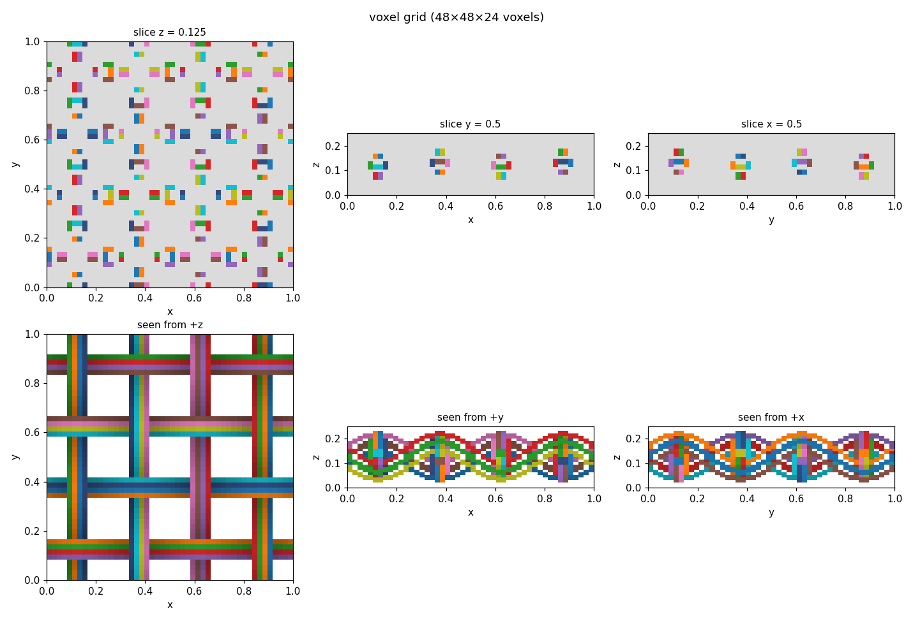

## twill_weave

[`twill_weave.json`](../../examples/twill_weave.json) · 3D 1×1×0.2 ·  · generator `weave` · 16 shapes

> Twill 2/2 weave: every yarn passes over two and under two crossing yarns, shifted by one from yarn to yarn, which gives the diagonal rib. Warp and weft carry their own phase, so the voxel grid tells them apart.

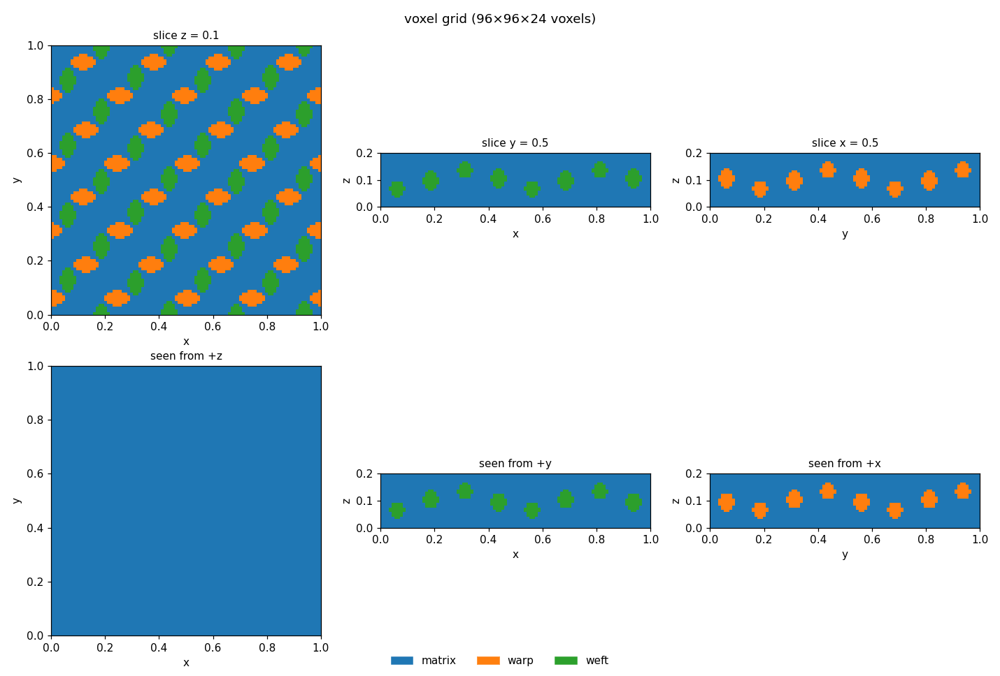
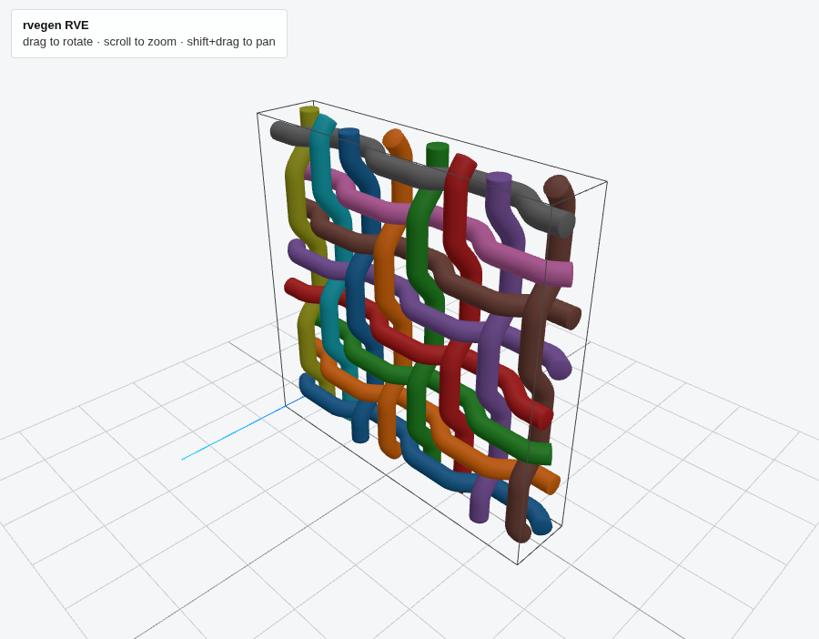

## voronoi_2d

[`voronoi_2d.json`](../../examples/voronoi_2d.json) · 2D 1×1 ·  · generator `voronoi_2d` · 24 shapes

> 2D Voronoi polycrystal. Deterministic generator: seeds come from n_seeds + seed; the termination section is not needed.

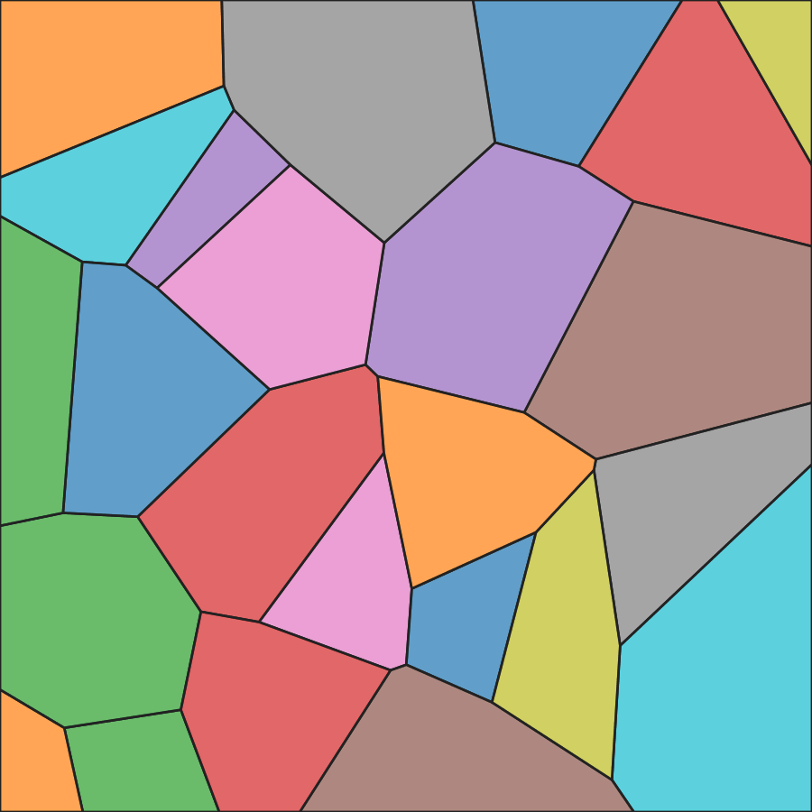
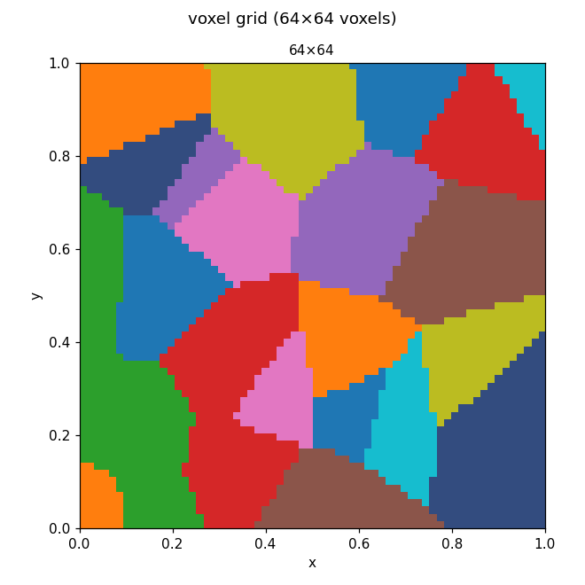

## voronoi_2d_gmsh

[`voronoi_2d_gmsh.json`](../../examples/voronoi_2d_gmsh.json) · 2D 1×1 ·  · generator `voronoi_2d` · 30 shapes

> 2D Voronoi polycrystal as a conforming gmsh geometry: the grains share their boundary curves, so the mesh has no gaps or doubled nodes between grains, and every grain is a physical group of its own.

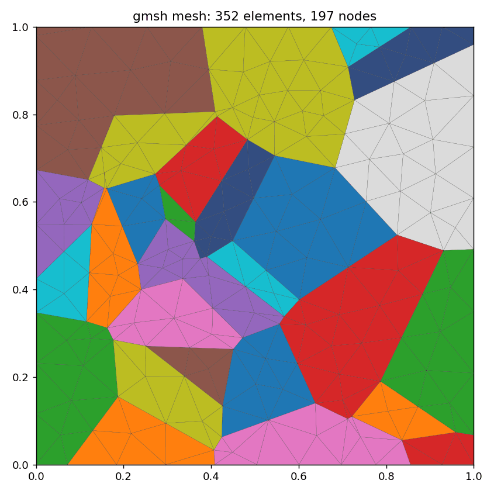

## voronoi_2d_periodic

[`voronoi_2d_periodic.json`](../../examples/voronoi_2d_periodic.json) · 2D 1×1 ·  · generator `voronoi_2d` · 57 shapes

> Periodic 2D Voronoi polycrystal: grains that cross a face of the box continue on the opposite face, so the cell tiles the plane. Compare the left and right edge of the picture.

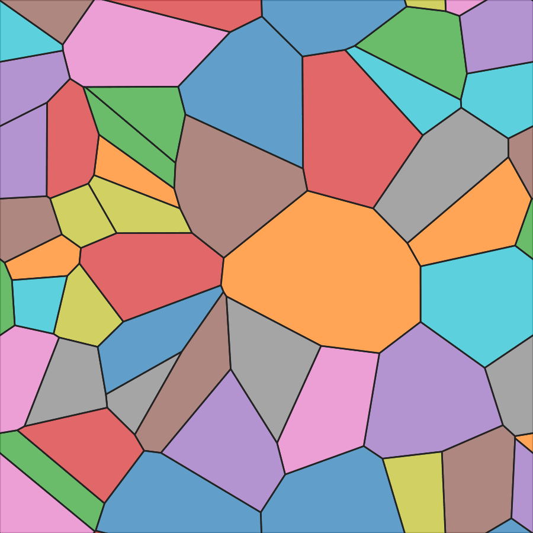
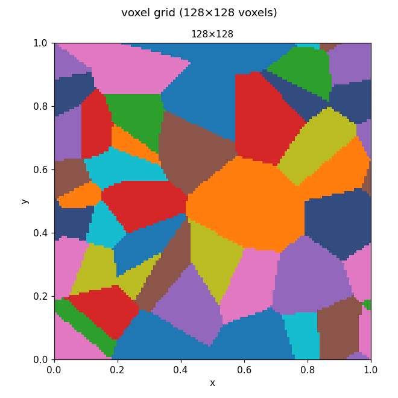

## voronoi_3d

[`voronoi_3d.json`](../../examples/voronoi_3d.json) · 3D 1×1×1 ·  · generator `voronoi_3d` · 12 shapes

> 3D Voronoi polycrystal on a unit cube, voxelised for FFT.

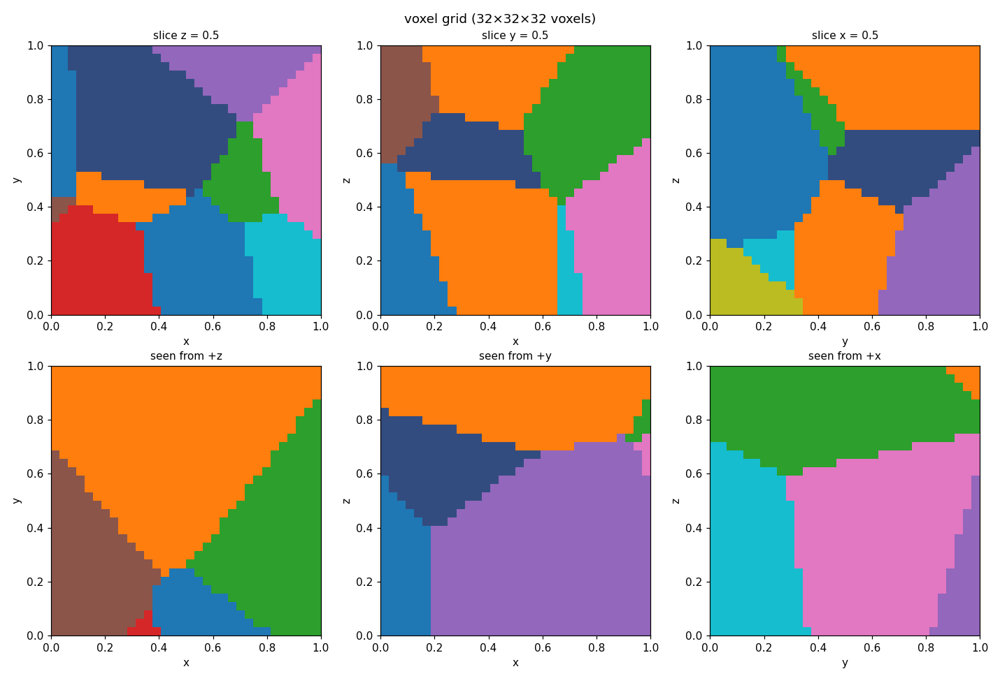

## voronoi_3d_grain_sizes

[`voronoi_3d_grain_sizes.json`](../../examples/voronoi_3d_grain_sizes.json) · 3D 1×1×1 ·  · generator `voronoi_3d` · 114 shapes

> Periodic 3D polycrystal with a prescribed grain-size distribution: the equivalent grain diameters follow a lognormal distribution with the given mean and spread (a weighted tessellation fitted to the drawn sizes), instead of whatever a plain Voronoi tessellation of random seeds happens to give.

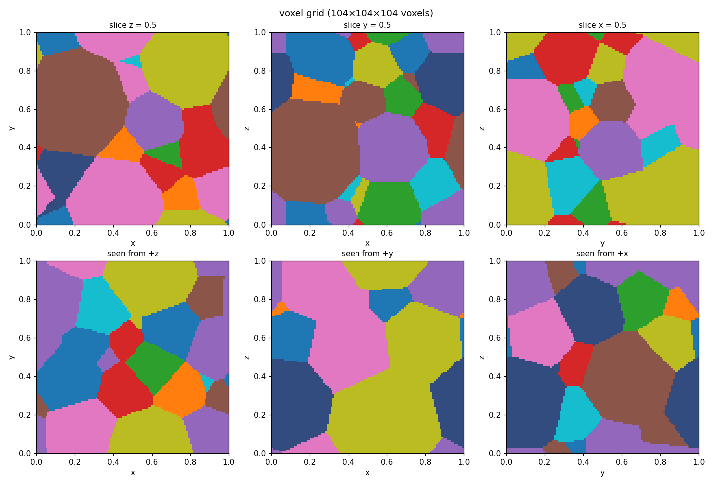
