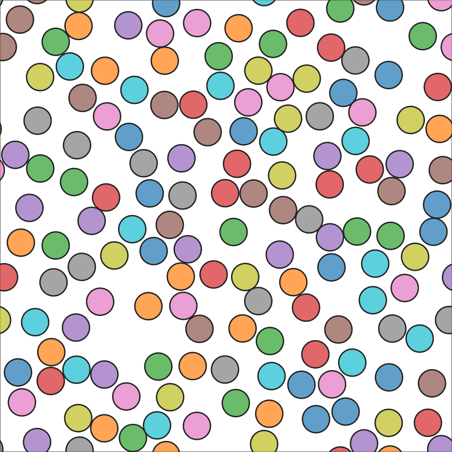
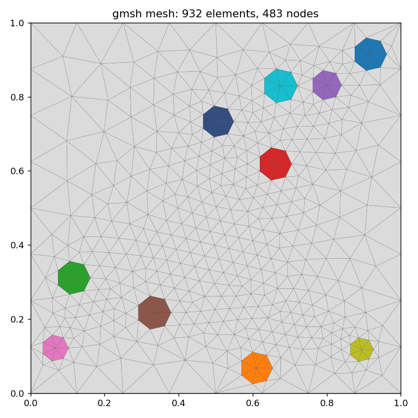
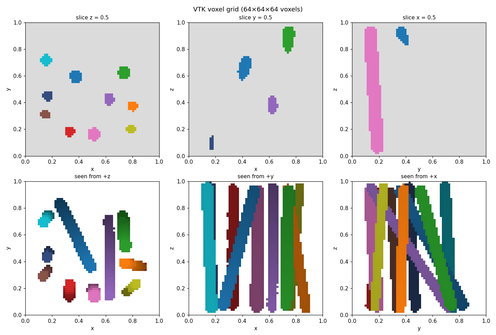
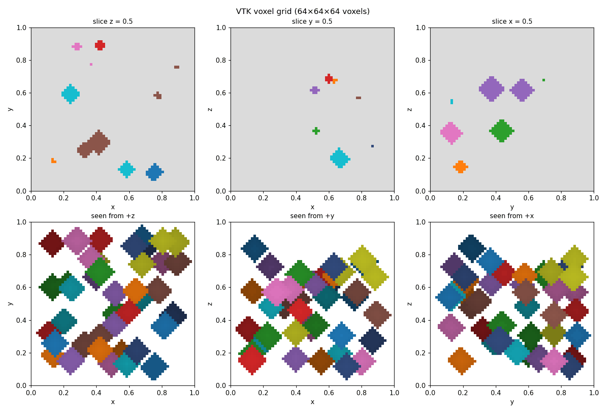
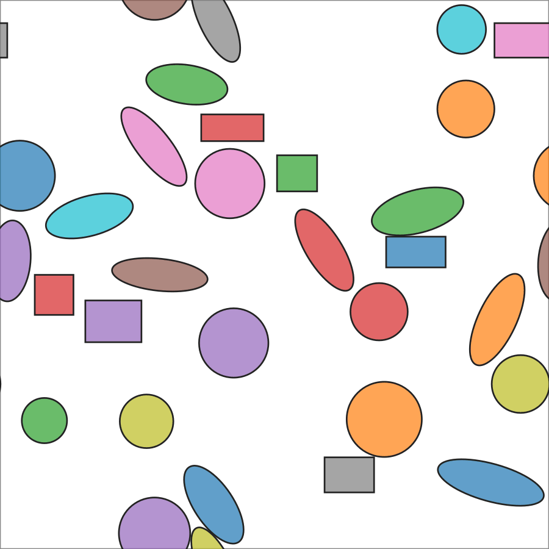
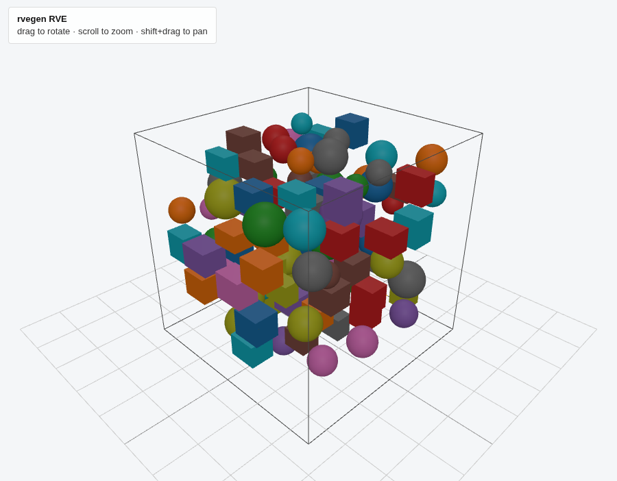
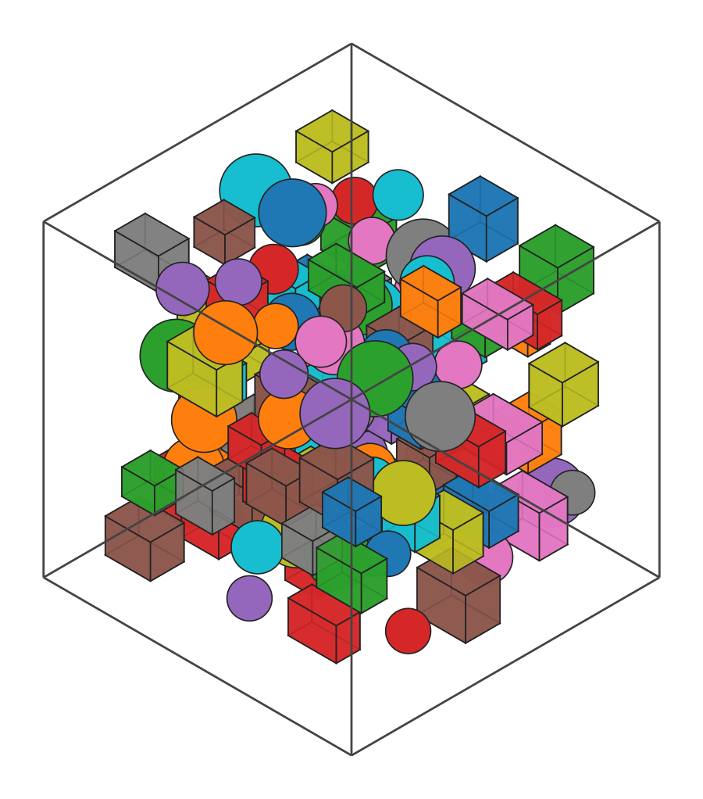
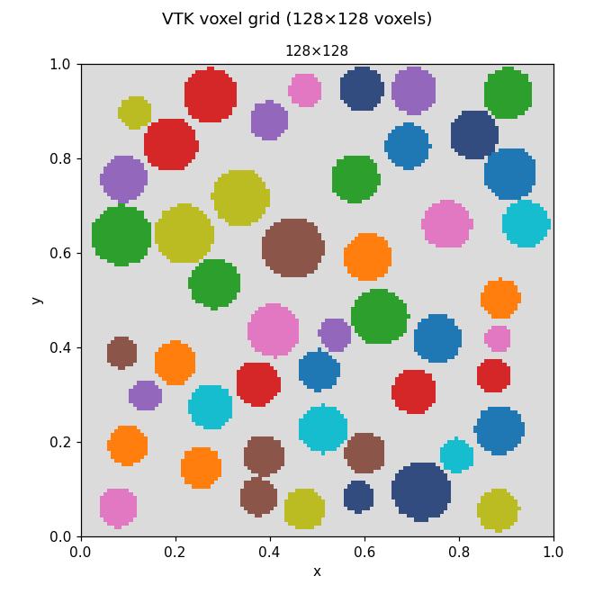
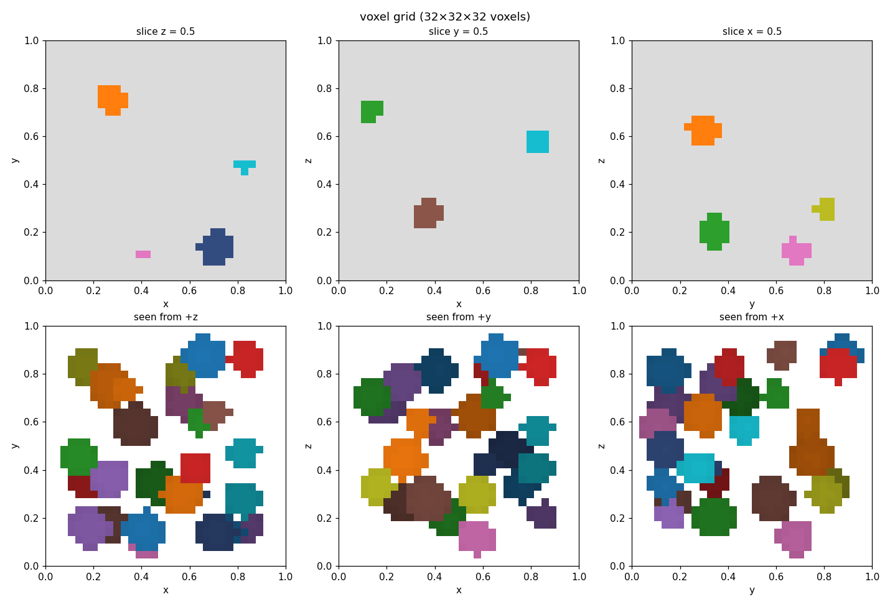

# rvegen example gallery

<!-- Generated by scripts/make_gallery.py; do not edit by hand. -->

Every picture below is rendered from a config in `examples/`. Regenerate with
`scripts/make_gallery.py` or `cmake --build build --target gallery`.

The gallery script resolves each config's relative input paths (`mesh_path`) against
the config's directory. Run by hand, `examples/mesh_inclusions_3d.json` needs the
working directory `examples/` (`cd examples && rvegen mesh_inclusions_3d.json`).

The `gmsh_geo` pictures were meshed with gmsh 4.12.1; other gmsh
versions mesh differently, so the element counts in their titles change.

## circles_in_unit_box

[`circles_in_unit_box.json`](../../examples/circles_in_unit_box.json) · 2D 1×1 · circle_input · generator `only_inside` · 10 shapes

## circles_statistics

[`circles_statistics.json`](../../examples/circles_statistics.json) · 2D 1×1 · circle_input · generator `periodic` · 161 shapes

> Dense periodic monodisperse circle pack (40 % area fraction) with the statistics post-process: two-point correlation S2(r), which starts at the area fraction and decays to its square, and the radial distribution g(r) of the centres, which shows the hard-core exclusion and the first-neighbour peak.

## circles_with_voxelize

[`circles_with_voxelize.json`](../../examples/circles_with_voxelize.json) · 2D 1×1 · circle_input · generator `only_inside` · 10 shapes

## dense_circles_svg

[`dense_circles_svg.json`](../../examples/dense_circles_svg.json) · 2D 1×1 · circle_input · generator `only_inside` · 48 shapes

> Dense 2D RVE — 30% volume fraction of mixed-radius circles in a unit box. only_inside generator + precise dispatch packs more circles than AABB-only would. SVG output for visualization.

## dense_spheres_3d

[`dense_spheres_3d.json`](../../examples/dense_spheres_3d.json) · 3D 1×1×1 · sphere_input · generator `only_inside` · 48 shapes

> Dense 3D RVE — spheres in a unit cube, ~10% volume fraction. Three.js HTML output: drag to rotate, scroll to zoom in your browser.

## dense_spheres_svg3d

[`dense_spheres_svg3d.json`](../../examples/dense_spheres_svg3d.json) · 3D 1×1×1 · sphere_input · generator `only_inside` · 48 shapes

> Dense 3D sphere RVE rendered as static SVG (orthographic axonometric).

## fe_rve_workflow

[`fe_rve_workflow.json`](../../examples/fe_rve_workflow.json) · 2D 1×1 · circle_input · generator `periodic` · 33 shapes

> End-to-end FE-RVE workflow demo. Periodic 2D circle pack at 20% fibre fraction. Emits a gmsh .geo with every knob the FE-RVE workflow typically needs: periodic Curve directives, characteristic element size, quadratic element order, Frontal-Delaunay algorithm (6; algorithm 8 segfaults gmsh 4.12 when periodic constraints are present), and tri->quad recombination. Run gmsh on the resulting .geo and you get a periodic quad mesh ready for meshing in gmsh. Note on Physical groups: shapes carry the phase_name 'fibre' on their info blob, but the gmsh writer's JSON schema doesn't (yet) accept a phase_collection so the produced .geo doesn't emit `Physical Surface("fibre", ...)` directives — that requires attaching the collection in C++ via set_phases(&phases). The JSON-config phase-group hookup is a separate follow-up.

## fibres_3d

[`fibres_3d.json`](../../examples/fibres_3d.json) · 3D 1×1×1 · polyline_tube_input · generator `only_inside` · 10 shapes

> Straight cylindrical fibres (polyline tubes) running roughly along z through a unit cube, voxelised to 64^3 and shown as three orthogonal mid-plane slices. Tubes have no precise collision pair yet, so placement uses conservative bounding-box checks.

## mesh_inclusions_3d

[`mesh_inclusions_3d.json`](../../examples/mesh_inclusions_3d.json) · 3D 1×1×1 · mesh_inclusion_input · generator `only_inside` · 40 shapes

> Arbitrary inclusion geometry from a triangle mesh: copies of an octahedron read from data/octahedron.stl, placed without overlap and voxelised to 64^3. The mesh_path is relative to the working directory, so run it from the examples/ directory: cd examples && rvegen mesh_inclusions_3d.json.

## mixed_2d_periodic_gmsh

[`mixed_2d_periodic_gmsh.json`](../../examples/mixed_2d_periodic_gmsh.json) · 2D 1×1 · circle_input, ellipse_input, rectangle_input · generator `periodic` · 35 shapes

> Periodic 2D RVE mixing circles, ellipses and rectangles, written as a gmsh .geo with periodic boundary constraints. Inclusions that cross the boundary are clipped and their wrap copies appear on the opposite face.

## mixed_2d_svg

[`mixed_2d_svg.json`](../../examples/mixed_2d_svg.json) · 2D 1×1 · circle_input, ellipse_input, rectangle_input · generator `only_inside` · 45 shapes

> Mixed circles + rectangles + ellipses, 25% volume fraction, only_inside generator. Shows the heterogeneous-shape capability with precise pairwise collision dispatch.

## mixed_3d

[`mixed_3d.json`](../../examples/mixed_3d.json) · 3D 1×1×1 · box_input, sphere_input · generator `only_inside` · 123 shapes

> Mixed 3D RVE — spheres + boxes in a unit cube, 15% volume fraction.

## mixed_3d_svg

[`mixed_3d_svg.json`](../../examples/mixed_3d_svg.json) · 3D 1×1×1 · box_input, sphere_input · generator `only_inside` · 123 shapes

> Mixed 3D RVE — spheres + boxes — rendered as static SVG.

## periodic_circles

[`periodic_circles.json`](../../examples/periodic_circles.json) · 2D 1×1 · circle_input · generator `periodic` · 15 shapes

> Periodic 2D RVE: circles wrapping across box faces, written as a ParaView-readable VTK file. Canonical config for FFT-based homogenization.

## periodic_ellipses_svg

[`periodic_ellipses_svg.json`](../../examples/periodic_ellipses_svg.json) · 2D 1×1 · ellipse_input · generator `periodic` · 28 shapes

> Periodic 2D RVE with rotated ellipses. Note how shapes near the boundary get visible wrap-copies on the opposite face — this is what FFT homogenization actually sees as the periodic unit cell.

## periodic_spheres_gmsh_3d

[`periodic_spheres_gmsh_3d.json`](../../examples/periodic_spheres_gmsh_3d.json) · 3D 1×1×1 · sphere_input · generator `periodic` · 27 shapes

> Periodic 3D sphere pack written as a gmsh .geo with periodic surface constraints, ready for a tetrahedral FE mesh. Spheres that cross a face are clipped and their wrap copies appear on the opposite face.

## polydisperse_circles

[`polydisperse_circles.json`](../../examples/polydisperse_circles.json) · 2D 1×1 · circle_input · generator `only_inside` · 48 shapes

> Polydisperse circles with normally distributed radii (mean 0.05, standard deviation 0.01) packed inside the box, voxelised to a 128x128 grid for FFT solvers.

## spheres_in_cube

[`spheres_in_cube.json`](../../examples/spheres_in_cube.json) · 3D 1×1×1 · sphere_input · generator `only_inside` · 26 shapes

> 3D RVE: spheres packed into a unit cube, terminated by volume fraction. The voxel writer outputs a 32^3 phase-id grid suitable for FFT homogenization.

